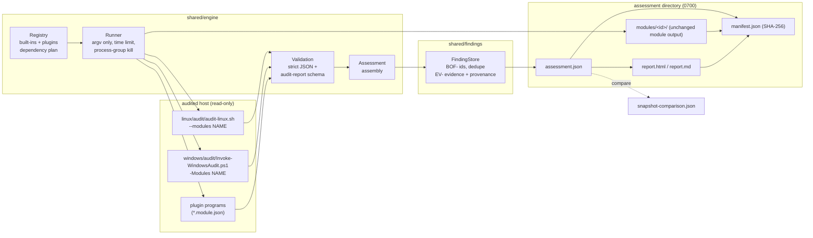

# Assessment engine

`python -m shared.engine` turns the platform collectors into one assessment: it runs a **profile** (a named list of **modules**), validates what each module returns, merges the results into a single **assessment** document with centrally managed findings and evidence, and renders reports. It is the layer that makes BlueOps a platform instead of a set of scripts.

> **Status:** implemented and tested on Linux (Bash collectors, real runs against synthetic fixtures). The Windows wiring is unit-tested with a fake PowerShell resolver but has **not been run against a real PowerShell** in development; see [Limitations](#limitations).

## Architecture



```
profile ──> registry.plan() ──> for each module (sequential, dependencies first)
                                   │ run_module(): build argv -> start -> wait(timeout) -> kill tree
                                   │ parse report.json strictly -> validate against audit-report schema
                                   v
                   FindingStore.add_report()  (identity, dedupe, evidence, provenance)
                                   v
                   assessment.json  + report.{html,md} + manifest.json
```

### Design decisions

- **Collectors stay independent.** The engine never inspects the host. Bash and PowerShell collectors keep working alone and without Python ([architecture.md](architecture.md)); the engine is optional glue for hosts (or analyst machines) that have Python 3.9+.
- **One process per module.** A crash, hang or timeout in one module cannot affect another and every module has its own time limit. Cost: the collector start-up is paid per module (about 0.2 s each for the Bash collector on the development host; a full default run over the synthetic fixture host took about 5 s).
- **Sequential execution.** CLAUDE.md puts service availability first; running modules in parallel on a stressed host would add load for little gain. Parallelism can be added later behind an explicit option.
- **Declarative plugins, no code loading.** A plugin is a JSON manifest plus a program. The engine never imports or evaluates plugin code ([plugins.md](plugins.md)).
- **Module output is evidence.** Each module's output directory (report, `report.txt`, `run.log`, its own `manifest.json`, `stdout.txt`, `stderr.txt`) is kept unchanged under `modules/<id>/` and hashed by the assessment manifest. The central document is a *derived view* whose findings can be traced back to those files (`sources`, `provenance`).
- **Findings are identified by `(host, check id, category)`**, not by severity or evidence, so a finding that gets worse is the same finding ([findings.md](findings.md)).
- **No new runtime dependency.** Schema validation uses `shared/reporting/schema_lite.py`, a small validator for exactly the JSON Schema keywords the repository uses; it refuses unknown keywords instead of ignoring them and is checked against `jsonschema` by the test suite.

## Commands

```bash
python -m shared.engine list [--platform linux|windows] [--plugin-dir DIR] [--json]
python -m shared.engine run --output-dir DIR [--profile NAME|FILE] [--modules a,b] [--timeout S]
                            [--fail-on SEV] [--report html,markdown|none] [--compare PATH ...]
                            [--plugin-dir DIR ...] [--json] [--quiet]
python -m shared.engine compare BASELINE CURRENT [--format json|markdown] [--output FILE]
python -m shared.engine report ASSESSMENT [--format html|markdown|json] [--compare PATH ...] [--output FILE]
python -m shared.engine validate FILE
python -m shared.engine verify DIR [--expect-sha256 DIGEST]
```

`--output-dir` is mandatory for `run`: the engine writes nothing unless you name a location. It creates `blueops-assessment-<UTC>-<profile>/` (mode 0700; never reuses a directory; files are created exclusively with mode 0600).

### Examples

```bash
# Everything this host supports, read-only; HTML + Markdown report beside the JSON.
sudo python -m shared.engine run --output-dir /var/lib/blueops

# Fast triage (accounts, processes, listeners, services), custom threshold.
sudo python -m shared.engine run --profile quick --fail-on high --output-dir out

# Two specific modules, 60 s each, JSON on stdout (human text on stderr).
sudo python -m shared.engine run --modules users,network --timeout 60 --json --output-dir out > assessment.json

# Run now and compare with two earlier snapshots (newest first); the report gains a history section.
sudo python -m shared.engine run --output-dir out --compare snapshots/2026-02 --compare snapshots/2026-01

# Compare two snapshots (assessments, run directories or plain audit reports) and write JSON.
python -m shared.engine compare snapshots/2026-02 out/blueops-assessment-* --output cmp.json

# Re-render an old assessment as Markdown.
python -m shared.engine report snapshots/2026-02 --format markdown > report.md

# Check that nothing was altered after the run (digest recorded off-host at run time).
python -m shared.engine verify out/blueops-assessment-* --expect-sha256 <digest>
```

On a Windows host the same commands apply with `py -m shared.engine ...`; modules run through `pwsh` or `powershell.exe`, whichever is found.

### Exit codes

The contract in [contracts.md](contracts.md) applies. `run`: **0** everything ran and nothing reached `--fail-on`; **4** a finding at or above the threshold (wins over gaps, as everywhere); **6** no such finding but a module did not finish cleanly; **3** nothing could run (all modules skipped) or a plugin/profile was rejected; **2** usage; **1** every module failed or an internal consistency check failed. `compare`: **0** identical, **4** anything differs, **6** nothing differs but the comparison is incomplete, **3** snapshots cannot be compared or are unreadable. `validate` and `verify`: **0** or **3**.

## Module interface

Every module has metadata (`shared/engine/module.py: ModuleSpec`) and an execution contract.

| Field | Meaning |
|---|---|
| `id` | `<platform>.<name>`, e.g. `linux.users`; unique across built-ins and plugins |
| `platform` | `linux`, `windows` or `any`; a module for another platform is *skipped*, never started |
| `category` | `audit` or `persistence` (read-only categories only; the engine has no hardening or containment modules) |
| `requires` | module ids that must finish `ok` or `partial` first; they are added to the plan automatically and a failed dependency makes the dependent `skipped` |
| `provides` | inventory partitions (`domain:scope`) the module owns; if the module does not run, they are reported as *unavailable coverage* so a later comparison cannot read their emptiness as "removed" |
| `timeout_seconds` | hard limit; the whole process group is killed |
| `privilege` | `none`, `recommended`, `required` (informational today; elevation is reported by the collector in `host.elevated`) |
| `output` | `run-dir` (a `report.json` under the output directory) or `stdout` |
| `argv` | command template: `{repo}`, `{plugin_dir}`, `{output_dir}`, `{module}`, `{powershell}`; each placeholder lands inside one argv element |

Execution contract: the program exits **0** (nothing to report), **4** (findings), **6** (partial) after writing a schema-valid `audit-report` document (`shared/schemas/audit-report.schema.json`, 0.1.x/0.2.x). Exit **3** means "precondition not met" and marks the module `skipped`. Anything else is `failed`.

### Module statuses

| Status | Meaning | Findings and inventory used? |
|---|---|---|
| `ok` | exit 0/4 and a valid report | yes |
| `partial` | exit 6 and a valid report (coverage gaps are in `errors`) | yes, but absence proves nothing |
| `failed` | could not start, crashed, or an unexpected exit code | no |
| `timeout` | killed after the time limit | no |
| `invalid_output` | no report, unreadable JSON (duplicate keys, `NaN`, nesting bombs, bad UTF-8) or a schema violation | no |
| `skipped` | wrong platform, no PowerShell, unmet precondition, failed dependency | no |

### Built-in modules

Linux (`audit-linux.sh --modules NAME`): `system users pam auth processes network services persistence filesystem sysconfig`. Windows (`Invoke-WindowsAudit.ps1 -Modules NAME`): `system users processes network services tasks autoruns persistence firewall security eventlog filesystem`. A test (`tests/shared/test_engine_registry.py`) parses `linux/lib/common.sh` and `windows/lib/Common.ps1` and fails if the registry and the collectors disagree on module names or inventory partitions.

## Profiles and configuration

Profiles live in `profiles/<platform>/<name>.json` ([schema](../shared/schemas/assessment-profile.schema.json)); `--profile` accepts a name or a file path.

```json
{
  "schema_version": "0.1.0", "kind": "profile", "name": "full", "platform": "linux",
  "description": "Every module plus package-integrity verification (slow).",
  "modules": ["all"],
  "fail_on": "medium",
  "options": { "package_integrity": true }
}
```

`modules` holds ids or the single entry `all`. `options` is limited to what the collectors support (`recent_days`, `package_integrity`); a profile can select and parameterise modules but cannot add commands. Shipped: `default`, `quick`, `persistence-hunt` (both platforms) and `full` (Linux). Baseline-comparison tuning (ephemeral ports, ignored records) stays in the existing `--config` of `shared.reporting.diff` ([baseline-diff.md](baseline-diff.md)); the snapshot comparison reuses its defaults.

## Installation

There is no installer ([deployment.md](deployment.md)). Copy the repository to the host or analyst machine (verify it against a digest obtained out of band). Requirements: Python 3.9+ for the engine, nothing else; the collectors need Bash 4.2+ (Linux) or PowerShell 5.1+ (Windows). No network access is needed or used. Development tools (`pytest`, `ruff`, `jsonschema`) are listed in `requirements-dev.txt` and are not needed at run time.

## Testing

`tests/shared/test_engine_*.py`, `test_findings.py`, `test_snapshot_compare.py`, `test_render.py`, `test_schema_lite.py`: unit tests, real-subprocess tests (timeouts and process-tree kill, hostile output), integration tests that run the real Bash collector through the engine on the synthetic fixture host and prove the engine finds exactly what the monolithic collector finds, schema-parity tests against `jsonschema`, malformed-input tests over the existing invalid fixtures, and cross-platform tests (Windows-shaped reports compare and render; Windows modules are skipped on Linux; a Linux/Windows comparison is refused). See [development.md](development.md#testing-the-assessment-platform).

## Limitations

- Windows modules are started through `pwsh`/`powershell.exe`, but this wiring has **not been executed against a real PowerShell** during development (only argument construction and the skip path are unit-tested). The Windows collector itself has its own Pester suite, which runs on the Windows CI runner.
- No parallel execution; no resume of an interrupted assessment (a killed engine leaves a partial directory without `assessment.json`).
- stdout/stderr of a module are written to files without a size cap; a runaway module is bounded by its time limit, not by bytes.
- On POSIX a plugin's manifest, directory and launched files are refused if they are symlinks, owned by another user, or group/other-writable, and so is a directory chain with a group/other-writable non-sticky ancestor; on Windows ACLs are not inspected, so protect plugin directories yourself. Modules run with an allowlisted environment and a trusted `PATH` ([security-model.md](security-model.md)).
- Programs are found through the engine's own `PATH` (`pwsh`, `powershell`, non-absolute plugin commands) and inherit its environment; the Linux collector sanitises its own `PATH`, the engine does not ([security-model.md](security-model.md#assessment-engine)).
- The engine records `privilege` metadata but does not elevate or check it; run it with the privileges you want the collectors to have.
