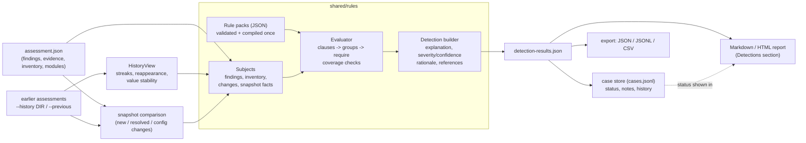

# Detection and correlation engine

`python -m shared.engine detect ...` evaluates **rules** (JSON data, not code) over an assessment and, optionally, over the snapshots before it. It produces explainable **detections**: what was matched, which findings and evidence contributed, why, how sure the rule is, and what to do next. It never reads a host and never claims that anything is malicious.

> **Not to be confused with** `python -m shared.reporting.detect` (the v0.3 rules over *baseline diffs*, [detection-rules.md](detection-rules.md)). That tool is unchanged and still works on two audit reports. The engine described here works on **assessments** ([assessment-engine.md](assessment-engine.md)): central findings, evidence, inventory, snapshot comparison and history. Rule ids are `DR-...` (this engine) versus `BO-...` (the legacy tool); detection ids are `DT-...` versus `DET-...`.

## Telemetry sources

Rules can also read endpoint telemetry ([telemetry.md](telemetry.md)): clause `source` may be `telemetry` (current records; fields in the [telemetry docs](telemetry.md#querying)) or `telemetry_changes` (added/removed/changed records against `--telemetry-baseline`), `requires_coverage` accepts `telemetry:<category>[/<scope>]`, and rule examples accept `telemetry` / `previous_telemetry` specs. Without telemetry such rules are `not_applicable`; with unavailable coverage they are `indeterminate`.

## Architecture



| Layer | Module | Responsibility |
|---|---|---|
| Conditions | `shared/rules/conditions.py` | The condition language; compile once, evaluate many times, explain true leaves |
| Subjects | `shared/rules/subjects.py` | The fields each *source* exposes (catalog used for validation) and the flat views built from assessment data |
| Rules | `model.py`, `validate.py`, `loader.py` | Rule model, validation with diagnostics, loading/overrides |
| History | `history.py`, `timeline.py` | Earlier snapshots without a database; detections across snapshots |
| Evaluation | `engine.py` | Clause matching, joins, `require`, coverage, detection building |
| Workflow | `investigation.py` | Append-only case store, statuses, notes, related detections |
| Presentation | `shared/reporting/render_detections.py`, `export.py`, `cli.py` | Reports, export, commands (kept separate from evaluation) |
| Content | `shared/rules/library/*.json`, [detection-library.md](detection-library.md) | 29 rules, each with executable examples |

### Design decisions

- **Rules are data.** A rule is a JSON object that can be validated, diffed, enabled/disabled and shipped without code changes. Alternative considered: Python classes per rule. Rejected: harder to validate, document and ship, and it would make "rule pack from an untrusted source" a code-execution question.
- **One model for single and correlated rules.** A rule has *clauses* (each: a source and a condition) and a boolean `require` over clause ids. A single-clause rule is the simple case; correlation is the general case. This is what makes correlation reusable instead of hard-coded.
- **Findings are evidence for rules, not their only input.** Rules can match inventory records (account uids, listeners, mounts), snapshot changes (config added/removed/modified, new/resolved findings, severity increases) and snapshot-level facts (previous snapshot clean, coverage lost). Inventory-based rules are more precise than matching finding titles.
- **Explicit severity, never automatic.** Severity is the rule's base value or the result of its own `severity_rules`, each with a stated reason. The number of matched items never changes it (tested, and mutation-checked).
- **Absence needs coverage.** A rule that concludes from the absence of something must declare the coverage it needs; if that coverage is incomplete the result is *indeterminate*, never a clean pass and never a detection.
- **State is separate from evidence.** The assessment and the detection results are immutable documents; analyst decisions live in a different file.
- **No database, no daemon.** History is a directory of assessments; cases are one JSON-lines file.

## Rule format

A rule pack (`kind: "rule-pack"`, [schema](../shared/schemas/detection-rule.schema.json)) holds rules. One rule:

```json
{
  "id": "DR-LNX-ACC-001", "version": "1.0.0", "name": "Non-root account with UID 0",
  "description": "...", "enabled": true,
  "platforms": ["linux"], "category": "accounts",
  "severity": "high", "severity_reason": "...",
  "confidence": "high", "confidence_reason": "...",
  "nature": "indicator",
  "requires_coverage": ["inventory:users"],
  "clauses": [
    { "id": "acct", "source": "inventory", "description": "A user record other than root has uid 0",
      "where": { "all": [
        { "field": "domain", "op": "eq", "value": "users" },
        { "field": "key", "op": "regex", "value": "^user:" },
        { "not": { "field": "key", "op": "eq", "value": "user:root" } },
        { "field": "attrs.uid", "op": "eq", "value": "0" } ] } }
  ],
  "join": { "on": "key", "mode": "equal" },
  "title": "Account {acct.key} has UID 0",
  "rationale": "...", "false_positives": ["..."], "confidence_boosters": ["..."],
  "investigation": ["..."], "remediation": "...",
  "references": {
    "attack": [ { "id": "T1136.001", "relationship": "possible", "explanation": "..." } ],
    "nist": ["AC-2", "AC-6"] },
  "examples": [ { "name": "...", "expect": "match", "current": { "inventory": [ ... ] } },
                { "name": "...", "expect": "no_match", "current": { ... } } ]
}
```

| Field | Meaning |
|---|---|
| `id`, `version` | `DR-<LNX\|WIN\|ANY>-<AREA>-<NNN>` and SemVer. A rule's meaning changes only with a version bump; ids are never reused. Detection ids do not include the version, so a rule update keeps cases attached. |
| `platforms` | `linux`, `windows` or `any`. A rule for another platform is reported `not_applicable`. |
| `enabled` | Default state; override with `--enable` / `--disable`. |
| `severity` + `severity_reason` | Base severity and *why*. `severity_rules` (`when` expression over clause ids, `value`, `reason`) are the only way it changes. Same for `confidence` / `confidence_rules`. |
| `nature` | `observation` (a confirmed configuration fact), `indicator` (suspicious; benign explanations exist), `correlated` (independent indicators that together raise a question), `hypothesis` (unverified). Validation ties it to the rule's shape: an `observation` has one required clause; `correlated` needs two required clauses or a `distinct` count; a `hypothesis` cannot claim a *direct* ATT&CK relationship. |
| `requires_coverage` | `module:<name>`, `inventory:<domain>[:scope]`, `comparison` (a previous snapshot with complete coverage), `comparison:exists`, `history:<N>` (at least N earlier snapshots). Declared coverage is mandatory when the rule reads snapshot changes or history fields, or concludes from absence. |
| `clauses` | `id`, `source`, `description`, `where` (required: a clause without a condition would match everything), `optional`, `min_matches`, `distinct: {field, count}`, `join_on`. |
| `require` | Boolean expression over clause ids: `"a"`, `{"all": [...]}`, `{"any": [...]}`, `{"not": e}`. Default: all non-optional clauses. |
| `join` | Group items by a field (`mode`: `casefold` default, or `equal`); each group is evaluated and reported on its own. With one clause it means "one detection per item"; with several it relates findings that share, for example, a file path (`evidence.paths`). Items without a join value are not grouped. |
| `title` | Template: `{host}` and `{clause.field}` (first matched item of the clause). Placeholders are validated. |
| `examples` | Executable cases: `match` (optionally `count`), `no_match`, `indeterminate`; `current` and `previous` (oldest first) are compact specs ([`shared/rules/fixtures.py`](../shared/rules/fixtures.py)). At least one positive and one negative are required. |

### Condition language

Leaf: `{"field": F, "op": OP, "value": V}`; compound: `{"all": [...]}`, `{"any": [...]}`, `{"not": c}`.

| Kind | Operators |
|---|---|
| Exact | `eq`, `ne`, `ieq` (case-insensitive) |
| Partial text | `contains`, `icontains`, `startswith`, `endswith` |
| Regular expression | `regex` (`re.search`; patterns length-capped, nested quantifiers rejected, inputs capped at 4096 characters) |
| Numeric | `gt`, `gte`, `lt`, `lte` (numeric strings are coerced), `len_eq`, `len_gte`, `len_lte` |
| Set membership | `in`, `not_in` (text compares case-insensitively) |
| Missing values | `missing`, `present` |
| Boolean | `is_true`, `is_false` (`true`/`false` strings count) |

Semantics that matter: a **missing** value (absent, null, empty string or list) makes every comparison false, including `ne` and `not_in`, so unknown is never read as "different"; test absence only with `missing`/`present`. A **list** field matches if any element matches (negations: none of the elements). The result also lists which leaf conditions were true; that list is the detection's `matched_conditions`.

### Sources and fields

| Source | One subject per | Notable fields |
|---|---|---|
| `findings` | current finding | `check_id`, `title`, `description`, `severity(_rank)`, `confidence`, `category`, `evidence.refs/excerpts/types/paths/count`, `standards.ids`, `sources.modules`, `history.*` |
| `inventory` | current inventory record | `domain`, `scope`, `key`, `attrs.<name>`, `evidence.refs` |
| `new_findings`, `resolved_findings`, `persistent_findings`, `severity_increased` | finding in the snapshot comparison | the finding fields, plus `baseline_severity`, `evidence.added/removed` |
| `config_changes` | inventory change (`added`/`removed`/`modified`) | `change`, `domain`, `scope`, `key`, `attributes.names`, `attrs.<name>`, `attr.<name>.before/after`, `history.before_stable_snapshots` |
| `snapshot` | the assessment pair | `previous.clean/complete/exists/...`, `new.count_ge_medium`, `new.categories`, `coverage.modules_degraded/removed`, `comparison.complete`, `history.snapshots` |

`evidence.paths` are file-system paths found in the evidence references and excerpts (POSIX and Windows); they let a rule relate a persistence finding that *mentions* a path with a filesystem finding that *lists* it. Very common paths (`/etc/passwd`) would relate unrelated findings, so join on them only between specific check ids. The full field catalog is `FIELDS` in `shared/rules/subjects.py`; validation rejects any other field name (with a suggestion).

## Correlation

A correlation explains itself in the detection (`explanation` and `matched_conditions`):

1. **Which findings contributed**: `contributing` lists each item with its clause, type (`finding`/`inventory`/`change`/`snapshot`), id or key, label and severity; `evidence` lists the EV- ids behind them.
2. **Why they were correlated**: `why_correlated` states the requirement (`all(a, b)`, ...), which clauses were satisfied with how many items, and the shared join value when grouped.
3. **Which conditions were satisfied**: `matched_conditions[].conditions` are the leaf tests that were true for the first matched item of each clause.
4. **What additional evidence would improve confidence**: unmatched *optional* clauses ("Optional corroboration not observed: ...") plus the rule's `confidence_boosters`.
5. **Why this severity**: `severity_rationale` quotes either the rule's `severity_reason` ("the number of matching items did not change it") or the explicit `severity_rules` entry that applied. `confidence_rationale` likewise.

Reusable building blocks, all in the rule data: `join` on a shared field, `min_matches`, `distinct` (at least N different values of a field, e.g. N different weaknesses), `optional` clauses with `severity_rules`/`confidence_rules`, `not` for contradictions with a baseline, `snapshot`/`config_changes`/`history.*` for change and history reasoning. The shipped correlations include privileged-account anomaly plus weak authentication, persistence entry plus the file it executes, open firewall plus exposed management ports, firewall change plus a new listener, scheduled-job change plus an account change, several authentication weaknesses, new findings after a clean assessment, and logging impairment plus persistence ([detection-library.md](detection-library.md)).

### Detection nature and honesty

Every detection carries `nature` and a `disclaimer` matching it ("it does not prove malicious activity" unless it is a plain observation, and even then it says the observation alone does not show malice). ATT&CK mappings carry a `relationship`: `direct` only for what a rule directly observes (none of the shipped rules claims it, because configuration data never shows an adversary action) and `possible` with an explanation of why the technique is related and what the data does not show. NIST SP 800-53 Rev. 5 control ids are listed by control, with titles. Confidence is lowered one step, with a stated caveat, when a module a rule depends on did not finish cleanly.

## Coverage, history and indeterminate results

For each rule the engine decides, before concluding anything:

| Situation | Result |
|---|---|
| Rule needs a previous snapshot / N earlier snapshots / configuration comparison that is not there | **indeterminate** (always) |
| A declared module or inventory partition is missing, failed, partial, or the comparison has indeterminate findings or lost modules, and nothing matched | **indeterminate** |
| Same, and something matched | detection, with a caveat and confidence lowered one step |
| Same, and the rule concludes from absence (`not`) | **indeterminate** (presence-based detections stand; absence-based ones cannot) |
| Rule disabled / other platform | `disabled` / `not_applicable` in `rule_results` |
| Rule raises an exception | recorded in `rule_errors`; other rules continue |

Indeterminate rules are listed with the reason in the results and in the report, and make the run exit 6 when nothing reached the threshold, so a missing module can never produce a clean exit.

**History** (`--history DIR`, `--previous PATH`): a directory of assessments (directories with `assessment.json`, `.json` files or plain audit reports) of the *same host*. Snapshots of another host or OS family, or not earlier than the current one, are excluded and listed in `history.excluded`; unreadable or manifest-failing entries are listed too (never silently dropped). Per finding the history gives `snapshots_present`, `consecutive`, `first_seen` and `reappeared`; each earlier snapshot counts as present, absent (the reporting module ran cleanly) or *unknown* (it did not): unknown stops a streak and is never read as "resolved". For config changes, `history.before_stable_snapshots` counts how many recent snapshots held the previous value, which is how a rule can express "changed after a long stable period".

**Across snapshots** (`detect compare A B [C ...]`): each snapshot is evaluated with the earlier ones as history. A detection is `new`, `persistent`, `intermittent` or `resolved`; it is resolved only if its rule was actually evaluated in the later snapshot, otherwise `unverified`.

## Investigation workflow

Detections do not carry a status. `--state-dir DIR` registers them as cases in `DIR/cases.jsonl`:

- statuses `new`, `acknowledged`, `investigating`, `resolved`, `dismissed`; allowed transitions are checked; **resolving or dismissing requires a note**; closed cases can be reopened (`investigating`);
- analyst notes, manual links between cases, and automatic *related detections* (those that share a contributing item or evidence in the same run);
- every event records time, analyst (`--actor`, default `$USER`) and action; the file is append-only, owner-only (0600/0700), written under a lock, and each line carries the SHA-256 of the previous one, so edits, deletions and reordering of earlier lines are detected when read (damage is an error with the line number, never skipped). Limits: dropping or editing the *last* line cannot be detected from the file alone, and the chain is not a defence against someone who rewrites the whole file; keep a copy off-host;
- a detection that was resolved or dismissed and is observed again is flagged `reappeared`; the decision is not silently reverted;
- the store holds ids, titles and analyst text only, never evidence content.

## Commands

```bash
python -m shared.engine rules list [--platform P] [--category C] [--nature N] [--min-severity S] [--json]
python -m shared.engine rules validate [PATH ...] [--examples] [--json]   # structure, fields, references, regex safety
python -m shared.engine rules show RULE_ID [--json]
python -m shared.engine rules test [--rule RULE_ID]                         # run the embedded examples
python -m shared.engine rules docs [--output FILE]                          # regenerate docs/detection-library.md

python -m shared.engine detect run ASSESSMENT [--history DIR] [--previous PATH ...] [--rules-dir PATH ...]
        [--enable ID] [--disable ID] [--state-dir DIR] [--min-severity S] [--fail-on S]
        [--format json|text|markdown|html] [--output FILE]
python -m shared.engine detect compare SNAPSHOT SNAPSHOT [SNAPSHOT ...] [--format json|text]
python -m shared.engine detect show RESULTS DT-ID [--state-dir DIR] [--json]
python -m shared.engine detect report RESULTS [--assessment PATH] --format markdown|html [--state-dir DIR]
python -m shared.engine detect export RESULTS --format json|jsonl|csv [--state-dir DIR]

python -m shared.engine case list|show|status|note|link --state-dir DIR ...
python -m shared.engine run --output-dir DIR --detect [--history DIR] [--state-dir DIR] [--rules-dir PATH]
```

`run --detect` adds `detections.json` and a Detections section to `report.html`/`report.md` inside the assessment directory (covered by its manifest). Exit codes (`docs/contracts.md`): **0** nothing at or above `--fail-on` and nothing indeterminate; **4** a detection at or above `--fail-on` (default `medium`; wins); **6** nothing reached the threshold but rules were indeterminate or failed, or the rule pack had errors; **3** unreadable input, damaged case file, invalid rule files, refused overwrite; **2** usage. `--min-severity` only hides detections in the output; the exit code reflects all of them.

### Examples

```bash
# Run now, with the last three assessments as history, and track cases.
sudo python -m shared.engine run --output-dir out --detect --history snapshots --state-dir cases
# Evaluate a saved assessment against your own rule pack plus the library.
python -m shared.engine detect run out/blueops-assessment-* --rules-dir my-rules/ --format text
# Triage.
python -m shared.engine case list --state-dir cases --status new
python -m shared.engine detect show out/blueops-assessment-*/detections.json DT-3f9a --state-dir cases
python -m shared.engine case status --state-dir cases DT-3f9a investigating
python -m shared.engine case status --state-dir cases DT-3f9a dismissed --note "documented break-glass account"
# What changed between the last three snapshots?
python -m shared.engine detect compare snapshots/jan snapshots/feb snapshots/mar
```

## Reports

The HTML report gains a **Detections** section (navigation entry, same visual language and the same single pinned script and Content-Security-Policy): overview counters, severity / confidence / nature / category distributions, affected host, filter chips (severity, confidence, nature, status), free-text filter, sort (severity, confidence, rule, status, title), expandable cards with why-flagged, how-it-matched, severity and confidence rationale, caveats, contributing findings (linked to the finding cards), evidence references (linked to the evidence index), what would improve confidence, benign causes, investigation steps, recommended action, framework references and investigation status with related detections. Rules that could not conclude, and rule errors, are shown in their own boxes. The Markdown report has the same content; `detect run --format markdown` produces a detections-only document. CSV export neutralises spreadsheet formula injection (values starting with `= + - @` get a leading apostrophe).

## Writing a rule

1. Start from an existing rule of the same shape in `shared/rules/library/` and give it a new id (`DR-<LNX|WIN|ANY>-<AREA>-<NNN>`).
2. Pick the source that holds the *evidence of the condition itself*: inventory for state (accounts, listeners, services, config), findings for collector judgements (command-content heuristics), changes for "since the last snapshot". Prefer inventory over matching free-text titles.
3. Write `where` using only catalog fields; use `present` before `ne`; use `in` for sets; keep regexes simple and anchored.
4. Decide the `nature` honestly and write `severity_reason` / `confidence_reason` as the answer to "why this and not higher?". Raise severity only with an explicit `severity_rules` entry whose `reason` an analyst could challenge.
5. Declare `requires_coverage` for every module/partition/comparison/history the rule depends on.
6. Fill `rationale`, `false_positives`, `confidence_boosters`, `investigation` and `remediation`; add ATT&CK references only where the relationship is real, mark it `possible` unless the rule observes the technique itself, and say in `explanation` what the data does not show.
7. Add examples: a positive, a negative, a *false-positive guard* (a case that looks similar but must not match), a missing-coverage case (`indeterminate`) and, for change rules, one with and one without a previous snapshot.
8. Run `rules validate --examples your-pack.json`, then `rules test`. If your pack is part of the library, run `rules docs` and update `docs/detection-library.md` (a test checks it).

`tests/shared/test_rules_library.py` enforces, for every shipped rule: valid, documented, proven by its own examples, ATT&CK ids well-formed and `possible` unless an observation, every check id it names exists in a collector (so a rename cannot silently disable a rule), no duplicate conditions, platform prefix consistent, docs in sync.

## Performance and bounds

Rules are compiled once; subject views are built once per source and shared by all rules; each clause is a single pass over its source (no per-rule re-parsing). Bounds: 2000 rules per pack, 1 MB per pack, 5000 matched items per clause, 50 listed items per clause and 100 detections per rule (all recorded as caveats when hit), 2000 detections per run, 200 snapshots of history, conditions of at most 200 nodes and depth 12. A test evaluates 100 rules over 3000 findings in well under the 10 s limit it asserts. Evaluation is deterministic and independent of input order.

## Limitations

- Rules see what the collectors collect. There is **no Windows privilege-assignment data** (user rights such as SeDebugPrivilege) and no event-log content, so no rule can reason about them; the Windows account/privilege rules use account state and group membership only.
- Group-membership rules report *that* membership changed; the before/after member lists are in the contributing item's `detail`, not interpreted (no "new member is unknown" logic).
- `evidence.paths` joins are textual; unrelated findings that mention the same common path will join if a rule joins on it.
- Regex safety is a mitigation (no nested quantifiers, capped inputs), not a proof of linear-time matching; rule packs should come from trusted sources.
- The case store's hash chain does not protect the last line or a fully rewritten file.
- The existing v0.3 detection rules (`shared.reporting.detect`) are not yet merged into this engine; both exist side by side.
- Only the PowerShell-independent parts were run in development: no rule here depends on a Windows collector having been executed (rules read assessment documents), but the Windows *collectors* they rely on remain unverified on a real host (see [implementation-report-v0.4.md](implementation-report-v0.4.md)).
